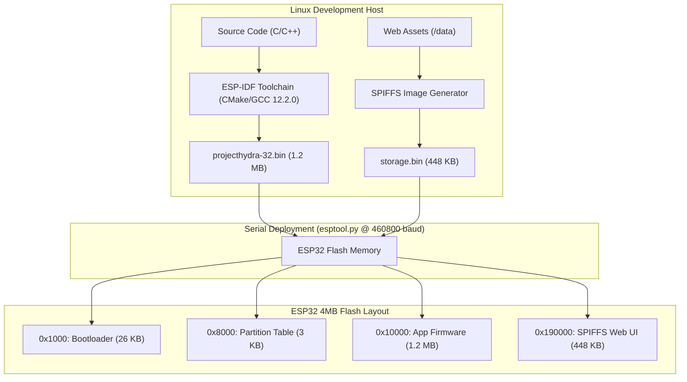

# 📡 ESP32 Wireless Security Auditing Node: Build & Deployment Guide


An end-to-end laboratory and engineering guide detailing how to build, partition, and flash bare-metal wireless auditing firmware (**Hydra-ESP**) onto an ESP32 microcontroller using Espressif's native **ESP-IDF v5.1** cross-compilation toolchain on Linux.

---

## 🏗️ System Architecture & Deployment Workflow



---

## 🛠️ Hardware Specifications
- **Microcontroller:** ESP32 DevKit V1 (ESP32-D0WD-V3, revision v3.1)
- **CPU:** Xtensa 32-bit LX6 Dual-Core @ 240MHz
- **Memory:** 520 KB SRAM, 4 MB External Flash
- **Radios:** 802.11 b/g/n Wi-Fi (2.4 GHz) + Bluetooth 4.2 / BLE (NimBLE stack)
- **Serial Interface:** `/dev/ttyACM0` / `/dev/ttyUSB0` via USB-UART

---

## 💾 Memory Layout & Flash Partitioning

The firmware requires a custom partition layout defined in `partitions.csv` to accommodate both the core firmware logic and an embedded **SPIFFS** (SPI Flash File System) partition holding the web control panel:

| Partition | Type | SubType | Flash Offset | Size | Purpose |
| :--- | :--- | :--- | :--- | :--- | :--- |
| **`nvs`** | `data` | `nvs` | `0x9000` | 24 KB | Non-Volatile Storage (WiFi creds, persistent settings) |
| **`phy_init`** | `data` | `phy` | `0xf000` | 4 KB | Radio physical calibration data |
| **`factory`** | `app` | `factory` | `0x10000` | 1.5 MB | Main application binary (`projecthydra-32.bin`) |
| **`storage`** | `data` | `spiffs` | `0x190000` | 448 KB | Asynchronous Web UI assets (HTML, CSS, JS) |

---

## 🚀 Step-by-Step Configuration & Embedding Guide

### 1. Prerequisites & ESP-IDF v5.1 Installation
Install prerequisite build packages and clone the ESP-IDF v5.1.2 framework:

```bash
# Clone ESP-IDF v5.1.2 with submodules
mkdir -p ~/esp && cd ~/esp
git clone -b v5.1.2 --recursive https://github.com/espressif/esp-idf.git

# Install tools for ESP32 target
cd ~/esp/esp-idf
./install.sh esp32

# Activate environment in current terminal
. ./export.sh
```

### 2. Configure Build Defaults
To ensure that target reconfiguration doesn't overwrite your custom partition scheme with generic single-app templates, ensure `sdkconfig.defaults` includes:

```ini
CONFIG_ESP32_WIFI_NVS_ENABLED=n
CONFIG_PARTITION_TABLE_CUSTOM=y
CONFIG_PARTITION_TABLE_CUSTOM_FILENAME="partitions.csv"
CONFIG_PARTITION_TABLE_FILENAME="partitions.csv"
```

### 3. Compile the Firmware & SPIFFS Image
Compile all components and automatically package the `/data` folder into the SPIFFS `storage.bin` image:

```bash
cd /home/kim/Downloads/Hydra-ESP
idf.py build
```

### 4. Embed / Flash the Firmware into ESP32
Connect your board via USB and flash the bootloader, partition table, application, and SPIFFS volume in a single pass:

```bash
idf.py -p /dev/ttyACM0 flash
```

*Or manually using `esptool.py`:*
```bash
esptool.py --chip esp32 -p /dev/ttyACM0 -b 460800 write_flash \
    0x1000 build/bootloader/bootloader.bin \
    0x8000 build/partition_table/partition-table.bin \
    0x10000 build/projecthydra-32.bin \
    0x190000 build/storage.bin
```

---

## 🔍 Verification & Operation

1. **Verify Boot Output:**
   ```bash
   idf.py -p /dev/ttyACM0 monitor
   ```
   *(Press `Ctrl + ]` to exit).*

2. **Access Web Control Panel:**
   - Connect to the Wi-Fi AP: `hydra` (Password: `notforfun`)
   - Navigate to: `http://192.168.4.1`

---

## 🛡️ Security Capabilities (Lab Environment)

- **802.11 Deauthentication Auditing:** Evaluates 802.11w Protected Management Frame (PMF) compliance across 4 modes (Normal, Combined, Multi-Clone, and aggressive BSSID clash).
- **Rogue AP & Evil Twin Simulation:** Deploys captive portal clones with active credential validation against the legitimate network to test user security awareness.
- **WPA/WPA2 Handshake & PMKID Capture:** Gathers 4-way EAPOL handshakes and clientless PMKIDs for offline dictionary resilience testing.
- **BLE Proximity Stress-Testing:** Broadcasts proximity pairing advertisements across Apple, Samsung, and Google ecosystems via the lightweight NimBLE stack.
- **Bluetooth Keystroke Injection (HID):** Emulates a wireless human interface device to assess automated script exposure on unlocked systems.
- **Promiscuous Frame Intrusion Detection:** Monitors management frame thresholds (>10 deauths/sec) to alert defenders to nearby radio jamming attempts.

---

## 📜 Credits & Upstream Attribution
- **Firmware Base:** Built upon [Hydra-ESP](https://github.com/SameerAlSahab/Hydra-ESP) by Sameer Al Sahab.
- **Foundational Project:** [esp32-wifi-penetration-tool](https://github.com/risinek/esp32-wifi-penetration-tool) by risinek.
- **Research Reference:** SpacehuhnTech (esp8266_deauther) & EvilAppleJuice.

---

## ⚠️ Legal & Ethical Disclaimer
This project is strictly for authorized laboratory security testing, educational research, and defense assessment on equipment owned by the operator.
